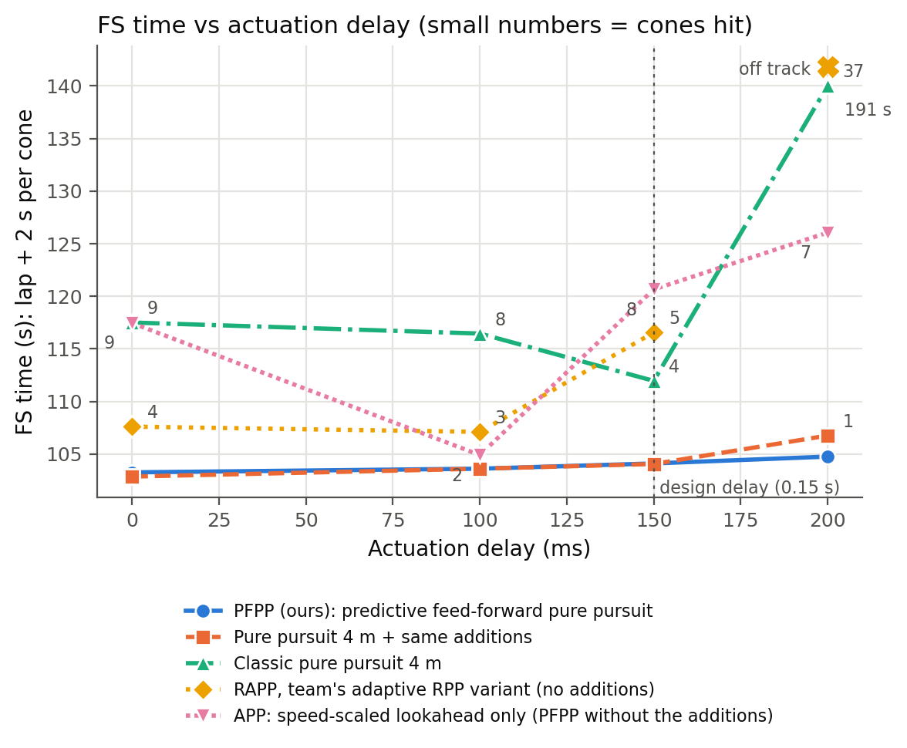

# PFPP: delay-robust path tracking for Formula Student Driverless

This repository contains **Predictive Feed-forward Pure Pursuit (PFPP)**, a steering controller for the Technion Formula Student Driverless car, and the **CARLA benchmark** used to develop and evaluate it. It was built as an undergraduate final project at the Technion (Faculty of Electrical and Computer Engineering, CRML lab).

In Formula Student Driverless the track is marked only by cones, and every cone the car knocks over adds 2 s to its time. A real car also reacts to a steering command only after a delay of roughly 0.1-0.3 s. Pure pursuit is simple and robust, but under such a delay it cuts corners and becomes unstable. PFPP keeps pure pursuit's geometry and adds four parts that remove those causes.



## Results

All laps were driven in CARLA 0.10.0 with an Audi TT on a 5 m wide cone corridor, scored as **FS time = lap time + 2 s per cone hit**. Every controller used the same car, racing line, speed plan, speed controller and actuation delay. The simulator is deterministic, so every lap reproduces exactly.

**FSG Hockenheim layout (1128 m), FS time in s (cones hit):**

| Actuation delay | PFPP | PFPP, fixed 4 m lookahead | Classic pure pursuit 4 m | APP | RAPP |
|---|---|---|---|---|---|
| 0 s | **103.25 (0)** | 102.85 (0) | 117.50 (9) | 117.45 (9) | 107.60 (4) |
| 0.10 s | **103.60 (0)** | 103.60 (0) | 116.45 (8) | 104.90 (2) | 107.10 (3) |
| 0.15 s (design) | **104.10 (0)** | 104.05 (0) | 111.95 (4) | 120.65 (8) | 116.55 (5) |
| 0.20 s | **104.75 (0)** | 106.75 (1) | 191.10 (37) | 126.05 (7) | left the track |

- **PFPP is the only controller with no cone hit at every delay.**
- **It does not depend on a well-chosen lookahead.** A wrong lookahead setting cost PFPP 0.6-1.7 s, against 5.4-9.7 s for the same controller with a fixed lookahead.
- **It works on tracks it has not seen.** On two unseen tracks, driven at 0.15 s without retuning, PFPP hit 2 cones on each (Brands Hatch 62.5 s, Montreal 111.85 s), against 9-38 for the other controllers.
- **It handles the first lap on an unknown track.** A kinodynamic RRT planner works only from the cones visible ahead (15 m, 120 deg) and PFPP tracks its plan. The lap was completed in 231.0 s without a cone hit, and also with noisy and missed detections (234.65 s, 0 cones).
- **It is cheap.** The steering law costs about 47 us per step in Python.

Tables for every condition: [`outputs/report_figures/carla_results.md`](outputs/report_figures/carla_results.md), [`carla_brandshatch_results.md`](outputs/report_figures/carla_brandshatch_results.md), [`carla_montreal_results.md`](outputs/report_figures/carla_montreal_results.md), [`carla_firstlap_results.md`](outputs/report_figures/carla_firstlap_results.md).

## How PFPP works

PFPP is pure pursuit with four additions. All of them are in [`fs_controller/lateral.py`](fs_controller/lateral.py), [`fs_controller/rapp.py`](fs_controller/rapp.py) and [`examples/run_carla_benchmark.py`](examples/run_carla_benchmark.py).

1. **Delay prediction.** The commands already sent but not yet applied are known. The pose is advanced through them with a kinematic bicycle model and the steering map, then moved to the rear axle. The controller steers from where the car will be when its command takes effect.
2. **Speed-scaled lookahead.** `L = clamp(0.45 * v, 3.5 m, 6 m)`, shortened to the radius of a tight corner ahead.
3. **Curvature feed-forward.** Pure pursuit's curvature contains a "chord" part that acts even when the car is exactly on the path. It turns the car in early at every corner entry and exit, which is the corner cutting. PFPP removes that part exactly and adds the path's own curvature:
   ```
   kappa_cmd = kappa_line + (kappa_pp - kappa_chord)
   ```
   `kappa_chord` is pure pursuit's command from the on-path pose, so the correction is zero when the car is on the line.
4. **Steering map.** The desired wheel angle is converted into an actuator command at every speed with `u = delta * (1 + c v^2) / A`, the form of the steady-state understeer relation. `A` and `c` are fitted from ordinary driving logs by [`scripts/identify_steering.py`](scripts/identify_steering.py). For the Audi, A = 0.574 rad and c = 0.0059 s^2/m^2.

Why the delay matters: for small errors, pure pursuit with an actuation delay `tau` is stable only while `v * tau / L < 0.52`, i.e. while the car travels less than about half the lookahead during the delay. With pure pursuit alone, a lookahead long enough for stability cuts corners. Prediction removes the delay, and the feed-forward removes the corner cutting, so the lookahead no longer has to do both.

Everything car-specific (wheelbase, size, steering map, grip limit, tightest turn) is in one vehicle file in [`config/vehicles/`](config/vehicles/). Moving the controller to the Formula Student car means filling in [`fs_car_template.json`](config/vehicles/fs_car_template.json), not changing code.

## Repository layout

| Path | Contents |
|---|---|
| `fs_controller/` | Controller package. **Used in CARLA:** `lateral.py` (pure pursuit, PFPP feed-forward, cross-track PID), `rapp.py` (lookahead law and braking-envelope speed target), `raceline.py`, `velocity_pid.py`, `vehicle.py`, `exploration.py` (first lap: cone perception, KinoRRT, tracking). The other modules (`powertrain.py`, `tire_grip.py`, `speed_planner.py`, `controller_stack.py`, `pure_pursuit.py`, `low_level.py`) belong to the earlier pure-Python simulation of the FS car and are not used by the CARLA benchmark. |
| `examples/run_carla_benchmark.py` | The benchmark runner: one lap per call, any controller, any delay, CARLA or an offline kinematic plant |
| `examples/summarize_benchmark.py` | Cone hits (from the logged path and the car's bounding box), FS time and tracking error for every run |
| `examples/spawn_hockenheim_cones_wide.py` | Spawns the cone corridor in CARLA |
| `examples/carla_video.py` | Chase and top-down video recording with overlays |
| `scripts/` | Batch scripts for every experiment, figure scripts, steering identification, track importer |
| `config/vehicles/` | Vehicle files: the Audi TT, two deliberately wrong steering models for the robustness test, and a template for the FS car |
| `inputs/racelines/`, `inputs/tracks/` | Racing lines and track centrelines (Hockenheim, Brands Hatch, Montreal) |
| `outputs/report_figures/` | Report figures and result tables |
| `outputs/carla/` | Logs of every CARLA run (`run_log.csv` and `meta.json` per lap) |
| `visualization/` | Track geometry and the pure-Python visualizations |
| `docs/` | `CARLA_INTEGRATION.md` (early integration notes, partly outdated) and the commit map of the 2026-10-16 history rewrite |

## Getting started

Requirements: Python 3.10+, `numpy`, `scipy`, `matplotlib`, `Pillow`; for CARLA runs the CARLA 0.10.0 Python wheel (from `PythonAPI/dist/` of the CARLA install); `ffmpeg` for video (optional); `trajectory_planning_helpers` only for re-optimizing racing lines (`scripts/optimize_raceline.py`).

### Without CARLA

A lap with an offline kinematic bicycle model. It checks the code path without the simulator; it is not a vehicle-dynamics simulation, so its lap times are not comparable with CARLA's.

```bash
python3 examples/run_carla_benchmark.py --controller pfpp --plant kinematic \
    --delay-steps 3 --speed-ref envelope --grip-cap
```

### In CARLA

1. Start CARLA (it opens the `FSD_Empty_Asphalt` level):
   ```bash
   pkill -f CarlaUnreal; ./CarlaUnreal.sh        # from the CARLA folder
   ```
2. Spawn the cones:
   ```bash
   python3 examples/spawn_hockenheim_cones_wide.py --keep --flip-y --width 5.0 --z 0.0
   ```
   Add `--clear --track brandshatch` (or `montreal`) for another track.
3. Drive a lap (0.15 s delay = 3 steps of 0.05 s):
   ```bash
   python3 examples/run_carla_benchmark.py --controller pfpp --delay-steps 3 --speed-ref envelope --grip-cap
   ```
   Other controllers: `--controller pp --pp-lookahead 4` (classic pure pursuit), `--controller rapp` (RAPP). Add `--record --record-gamma 0.6` for a video.
4. Score the runs:
   ```bash
   python3 examples/summarize_benchmark.py
   ```

If a script is killed while CARLA is in synchronous mode, the simulator waits for ticks; release it with `python3 examples/run_carla_benchmark.py --restore-async`.

### Reproducing the results

| Experiment | Command |
|---|---|
| Delay sweep and baselines | `bash scripts/final_batch.sh` |
| Robustness (lookahead, wrong steering model) | `bash scripts/robustness_batch.sh` |
| Unseen tracks | `bash scripts/unseen_track_batch.sh brandshatch`, `bash scripts/unseen_track_batch.sh montreal` |
| First lap on an unknown track | `bash scripts/first_lap_batch.sh` |
| Figures and tables | `python3 scripts/make_report_figures.py` (add `--track <name> --raceline inputs/racelines/<name>_audi_5m.csv` for the unseen tracks); `python3 scripts/make_exploration_figures.py` |

### Moving to another car

1. Copy `config/vehicles/fs_car_template.json` and fill in the wheelbase, size, grip limit and tightest turn radius.
2. Drive a few laps and fit the steering map: `python3 scripts/identify_steering.py <run folders>`. Put the printed `full_command_angle_rad` (A) and `speed_coeff_s2pm2` (c) into the file.
3. Run with `--vehicle <name>`.

If the steering model is uncertain, overestimate the car's steering strength. In the robustness test a model 20% too strong cost nothing, while one 20% too weak (the controller over-steers) cost 6.7 s.

## Project history

1. **Pure-Python simulation.** Vehicle model ported from the team's lap-time model, a minimum-curvature racing line for the FSG Hockenheim layout, and RAPP, an adaptive regulated pure pursuit written in this project, which drove a clean 101 s lap. Before this project the team had no path-tracking controller.
2. **CARLA.** The same layout as a cone corridor in CARLA, a fair benchmark runner, and an adjustable actuation delay. Under delay RAPP did not beat plain pure pursuit, and changing the lookahead did not remove the cone hits.
3. **PFPP.** An analysis of why pure-pursuit-type controllers hit cones under delay, and a controller that removes those causes. It was then tested for robustness, on unseen tracks and on a realistic first lap.

## Limitations

- The car is CARLA's Audi TT, not the Formula Student car (about 2 m wide instead of about 1.5 m).
- The Hockenheim racing line was planned with the FS car model. Its speed is capped to the Audi's grip; the unseen-track lines were planned for the Audi.
- The unseen tracks are scaled F1TENTH track shapes ([f1tenth_racetracks](https://github.com/f1tenth/f1tenth_racetracks), GPL-3.0), not real FS layouts.
- On the first lap, localization and cone colours are perfect; no SLAM runs in the loop.
- Cones in the CARLA level have no collision, so hits are computed from the logged path and the car's bounding box.

## Next steps

- Identify the steering map, delay and grip limit on the real car.
- Add a large-angle term to the steering map. PFPP's remaining cone hits on the unseen tracks are in the tightest hairpins, where the map is least accurate.
- Feed the first-lap cone map (or a SLAM map) into the racing-line optimizer: explore → map → optimize → race.
- Run PFPP as a ROS 2 node with the team's perception and SLAM.

## Author

Bishara Hakim, Technion Formula Student Driverless (autonomous team lead).
